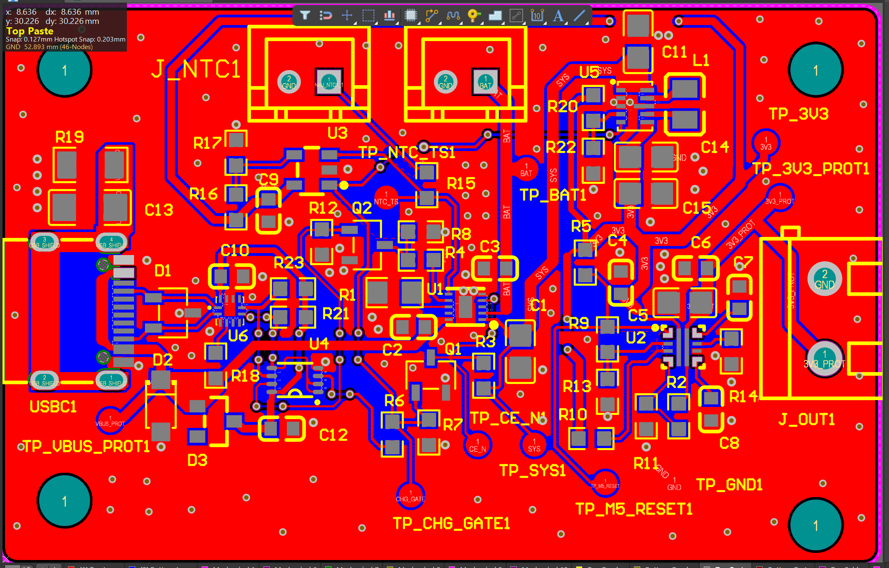
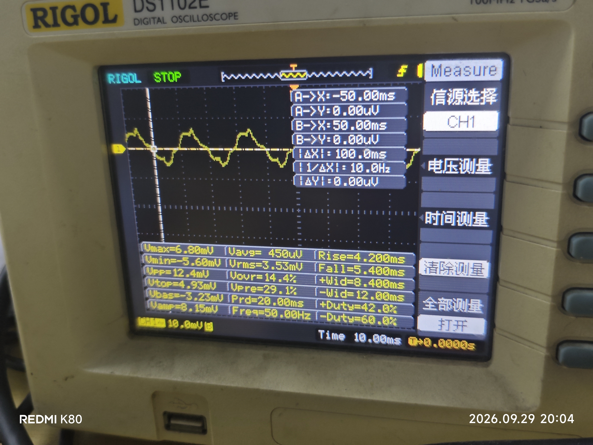
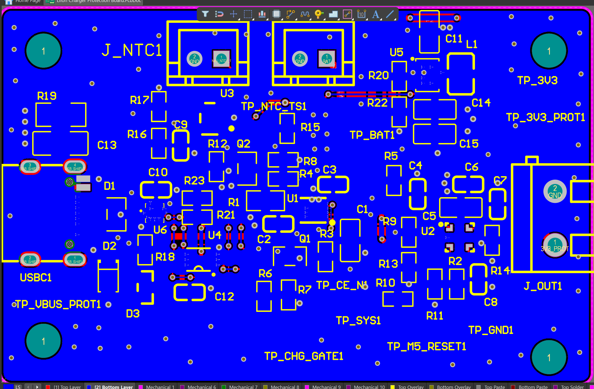

# Li-Ion Charger & Protection Board

面向 STM32、传感器及类似低压嵌入式负载的单节锂离子电池电源板，集成 USB-C 输入、单节锂电池充电、Power Path / Load Sharing、3.3 V Buck-Boost 稳压和输出保护。

Project Identity: LiIon Charger Protection Board

Current Project Stage: Stage 8 — Assembly, Bring-up and Hardware Test

Hardware Revision: Rev.A

Public Status: Rev.A — Fabricated, assembled, and primary-function Bring-up verified

Repository Design Files: Latest maintained Altium Designer source

> 仓库保留的是最新维护的 Altium 工程。PCB 设计包含 Rev.A 制造后的少量 layout refinement；仓库中的实测结果均对应实际 Rev.A 实板。

## 项目概览

Rev.A 以普通 5 V USB-C 输入和单节锂离子电池为两类输入源，目标是在 USB 接入时优先为系统供电并完成电池充电，在 USB 断开后由电池继续维持 3.3 V 系统输出。

项目范围聚焦硬件设计与验证，不包含固件需求。当前已完成原理图、PCB、PCBA、基础 Bring-up、实际充电测试和一次真实故障定位闭环。

<p align="center">
  
</p>
<p align="center"><em>当前维护设计版本的 Altium PCB 顶层视图；不是 Rev.A 实板照片或历史制造文件。</em></p>

## 主要功能

- USB-C 5 V 输入；
- 单节锂离子电池充电；
- USB / Battery Power Path 与无电池运行；
- 3.3 V Buck-Boost 稳压输出；
- 3.3 V 输出保护；
- 外接 NTC 温度资格链；
- 原理图、PCB、BOM 与 Altium Designer 源文件；
- 实板 Bring-up、Debug 与测量记录。

## 系统架构

```text
USB-C 5 V
   │
   ├─ CC / input protection
   │
   └─ BQ25185 charger + power path ── BAT
                    │
                   SYS
                    │
             TPS63802 buck-boost
                    │
                   3V3
                    │
             TPS259474 protection
                    │
                3V3_PROT
                    │
              External Load
```

主要器件包括：

- `BQ25185DLHR` — Charger / Power Path；
- `TPS63802DLAR` — 3.3 V Buck-Boost；
- `TPS259474LRPWR` — 输出保护；
- `TUSB320LAIRWBR` — USB-C CC / current advertisement detection；
- `PESD5V0U2BT,215` — CC ESD protection；
- `MF52D 103F3435-100` — 外接 10 kΩ NTC。

## Rev.A 实测结果

| 项目 | Rev.A 结果 |
| --- | --- |
| USB-only | `VBUS_PROT≈5.07 V / SYS≈4.67 V / 3V3≈3.30 V / 3V3_PROT≈3.29 V` |
| Battery-only | `BAT≈SYS≈3.95 V / 3V3≈3.31 V / 3V3_PROT≈3.29 V` |
| USB + Battery | USB 供电 + 电池充电状态已验证 |
| 充电电流 | 约 `0.49 A` |
| 重复插拔 USB | 多次检查中 `3V3_PROT` 稳态保持约 `3.29 V` |
| 3.3 V ripple / noise 观察 | 在记录的 probe / scope 条件下，代表性测量为 `Vpp≈12.4 mV`、`Vrms≈3.53 mV` |
| NTC Debug | 已定位并修复外接连接器间歇接触故障 |

<p align="center">
  
</p>

上述截图反映的是记录的 probe / scope setup 下的低频 ripple / noise observation。画面中约 `50 Hz` 的分量不解释为 TPS63802 switching frequency；该截图也不替代 loaded、带宽受控或高频 switching ripple 验证。

## Bring-up 与 Debug

充电 Bring-up 期间，`NTC_TS` 曾间歇降至约 0 V 并导致充电停止。排查先核对外接 NTC 与偏置电阻，再对电池和 NTC 的连接 / 断开状态进行对比测试。

最终将故障定位为外接 NTC 连接器接触不良。更换端子后运行恢复稳定；正常状态下 `NTC_TS≈0.46 V`，实测电池充电电流约 `0.49 A`，与 Rev.A 约 500 mA 的快充设计目标一致。

详细执行证据保留在 [`docs/bringup_log.md`](docs/bringup_log.md)。

## 硬件设计与 PCB

本仓库保留完整、真实的硬件工程工作区，而不是只保留展示摘要。需求、架构、器件选型、原理图审查、PCB 规则、PCB 审查和 Bring-up 记录均可继续追溯。

Altium 工程位于 [`hardware/altium_project/`](hardware/altium_project/)，便于直接查看的导出文件位于 [`hardware/outputs/`](hardware/outputs/)。

<p align="center">
  
  
</p>
<p align="center"><em>当前维护设计版本的 PCB 顶层 / 底层视图。</em></p>

当前 `.SchDoc` 与 Rev.A 设计基线一致。维护中的 `.PcbDoc` 包含实际 Rev.A 制造后的少量 layout / copper / via / solder-mask 调整，因此不将其描述为实板制造源的 byte-equivalent copy。当前维护设计版本可以重新生成新的 manufacturing outputs，但这些新输出只对应当前维护版本，不用于声明可精确复现历史 Rev.A manufacturing package。仓库内所有实测结论仍对应实际 Rev.A 实板。

## 工程文档导航

### 工程定义

- [Requirements baseline](requirements.md)
- [System block diagram](block_diagram.md)
- [Design notes](design_notes.md)
- [Reference / evidence index](references.md)

### 设计与审查记录

- [Critical component selection](docs/component_selection_plan.md)
- [System design overview](docs/project_design_overview.md)
- [Module-level circuit design](docs/module_design/README.md)
- [Formal schematic review](docs/schematic_review.md)
- [PCB design rules](docs/pcb_design_rules.md)
- [PCB layout / routing / release review](docs/pcb_review.md)
- [Assembly / Bring-up / Debug log](docs/bringup_log.md)

### 硬件文件

- [Hardware source and evidence guide](hardware/README.md)
- [Altium Designer project](hardware/altium_project/)
- [Schematic / BOM outputs](hardware/outputs/)

### 项目规则与流程

- [Framework binding](FRAMEWORK.md)
- [Project rules](PROJECT_RULES.md)
- [Documentation guide](docs/README.md)
- [Project validator](scripts/validate_project_repository.py)

项目级规则保留在本仓库中，因为它们属于正常工程工作区。可复用 Workflow 和通用方法论由独立的 [Hardware Project Framework](https://github.com/wum747349-debug/Hardware-Project-Framework) 仓库维护。

## AI 辅助工程

AI 工具用于辅助需求分析、datasheet 审查、器件选型比较、原理图 / PCB Review、测试规划、Debug 推理和文档维护。

AI 生成的建议本身不作为硬件证据。关键设计决策会根据适用情况对照原始资料、EDA 实现和实板测量结果核验；可复用的详细流程保留在独立 Framework 仓库中，不在此重复。

## 当前验证边界

Rev.A primary-function basic Bring-up 已完成，但以下项目仍为 deferred，不声明已经完成性能验证：

- 3.3 V / 500 mA continuous-load validation and loaded ripple;
- 1 A / 100 ms transient response;
- precise BUVLO shutdown / recovery thresholds;
- controlled over-current / short-circuit / UV / OV protection testing;
- efficiency and quantitative thermal characterization;
- precise NTC hot / cold trip thresholds and thermal hysteresis;
- stricter high-frequency ripple characterization.

这些 deferred 项目不代表仍存在基础功能故障，而是定义了 Rev.A 当前的验证边界。
